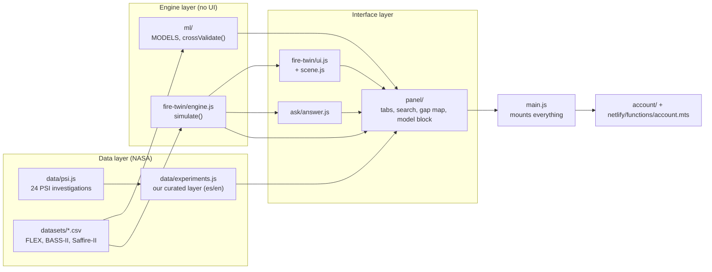

# Architecture

Astale is a static website with one small serverless function. There is no framework and no bundler: the browser loads ES modules from `src/` directly, and the build only copies them into `dist/`.

## Layers

**Data.** `src/js/data/psi.js` is generated by `scripts/fetch-psi.mjs` from the PSI API and must not be edited by hand. `experiments.js` and `experiments-en.js` add what PSI does not provide: summaries, fuel state, relevance per pillar and a safety reading. The CSV files in `src/datasets/` are produced by `scripts/export-model-data.mjs` from the PSI extract and `data/calibration.json`.

**Engine.** Pure calculation, no DOM. `fire-twin/engine.js` exposes `simulate(scenario)`, which returns the burn verdict, the CO curve and the effect of the crew's actions. `ml/` holds the learning code: seeded random numbers, decision tree, XGBoost-style and CatBoost-style boosting, the model list (`MODELS`) with the weighted ensemble, and the validation code (`crossValidate`, `metrics`). Everything is deterministic: same seed, same numbers.

**Interface.** `fire-twin/ui.js` builds the form, the cards and the animated `scene.js`; `panel/` builds the tabs, the free-text search, the gap map and the model block; `ask/answer.js` parses a free-text question and answers by calling `simulate()`. `main.js` is the only entry point.

## Module map

| Path | Responsibility | Main exports |
|---|---|---|
| `main.js` | Joins PSI with our layer, reads the language from `<html lang>`, mounts Panel, Fire Twin and accounts | none |
| `panel/index.js` | Panel screen: challenge points 1–4, tabs, floating "Ask Astale" chat | `mountPanel` |
| `panel/search.js` | Search over our own documents plus calculated answers | `crearBuscador` |
| `panel/gap-map.js` | Oxygen × pressure coverage map and the rules for filling gaps | `crearMapaHuecos` |
| `panel/model-block.js` | In-browser training, comparison, importance and prediction form | `mountModel` |
| `panel/model-docs.js` | Model documentation text (es/en) | `documentacionHTML` |
| `panel/links.js` | URL helpers (PSI, NTRS, local bridge) | `BRIDGE`, `PSI_URL`, `NTRS` |
| `fire-twin/data.js` | NASA-measured data, materials, sizes and spacecraft presets | `BASS2`, `ML`, `FLEX_FIT`, `MAT`, `PRESETS`… |
| `fire-twin/sources.js` | Cited sources with links | `SRC` |
| `fire-twin/engine.js` | The calculation | `simulate`, `ASSUME` |
| `fire-twin/texts.js` | Interface texts (es/en) | `T` |
| `fire-twin/ui.js` | Fire Twin screen | `mountFireTwin` |
| `fire-twin/scene.js` | Animated canvas scene | `createScene` |
| `fire-twin/ground-control.js` | Ground-control drawing and screen | `controlTierraHTML`, `pantallaControlTierra` |
| `fire-twin/tutorial.js` | Guided tour steps | `pasosTutorial` |
| `fire-twin/super-intelligence.js` | Card explaining where the Super-Intelligence is | `tarjetaSuperIntelligence` |
| `ml/index.js` | Entry point of the learning code | `rng`, `MODELS`, `metrics`, `crossValidate` |
| `ml/models.js` | Linear, forest, boosting, nearest neighbours and the ensemble | `MODELS` |
| `ml/validation.js` | 5-fold cross-validation, R², accuracy, AUC, permutation importance | `crossValidate`, `metrics` |
| `ask/answer.js` | Understands a question and answers by simulation | `parse`, `smartAnswer` |
| `account/account.js` | Sign-in, saved scenarios and activity log client | `mountAccount` |
| `core/morph.js` | Redraws HTML without recreating unchanged elements, so buttons keep hover and focus | `morph`, `pressFeedback` |
| `core/tour.js` | Spotlight tutorial overlay | `startTour` |

## Main flows

**Page load.** `index.html` loads `js/main.js`, which builds the PSI catalogue, mounts the Panel, moves the Fire Twin into its Panel block, and mounts the accounts widget.

**Scenario change.** Any control in the Fire Twin updates the scenario object, `simulate()` returns new numbers, the cards and the scene are redrawn, and a `scenario` event is dispatched.

**Model block.** When the block scrolls into view it fetches `datasets/flex_gotas.csv`, cross-validates each model one at a time (yielding to the browser between models), trains the final ensemble and enables the prediction form.

**Ask Astale.** `ask/answer.js` extracts spacecraft, material, oxygen and pressure from the question, runs `simulate()` and returns a direct answer with a breakdown; if it does not understand, it says so and lists what it can answer.

## Cross-module contracts

- **Language.** Pages are `index.html` (English) and `es.html` (Spanish); the code reads `<html lang>`. Texts use a local helper `t(es, en)`.
- **Events.** User actions dispatch `astale:event` on `document` with `detail.type` in `scenario`, `story`, `predict`, `ask`, `tab`; the accounts client listens to log activity.
- **Browser hooks** (used by accounts and the tests): `window.__panelTab(id, scroll)`, `window.__astaleTwin.get()/set()`, `window.__astaleAccount`.

## Rules the code follows

1. **Invent as little as possible.** Each number comes from NASA data (PSI, NTRS) or is flagged as our assumption, and assumptions live together in `ASSUME` (`engine.js`).
2. **No runtime dependencies on external AI.** Models are trained in the browser; fixed seeds make results reproducible.
3. **Be explicit about extrapolation.** Where there are no experiments (Moon, Mars) the interface says so.
4. **No bundler.** Plain ES modules, so anyone can read a file in the browser's developer tools.

## Build, deploy and tests

- `scripts/build.mjs` copies `src/` to `dist/` and fails if a required file is missing.
- Netlify publishes `dist/` and runs `netlify/functions/account.mts` (user accounts, stored in Netlify Blobs, signed cookie with `SESSION_SECRET`). Redirects and security headers are in `netlify.toml` and `src/_redirects`.
- `npm test` builds into a temporary folder and runs `tests/smoke/run.mjs` in a real browser: 35 Fire Twin scenarios, 8 Panel tabs, model training and an Ask answer, compared value by value with `tests/fixtures/baseline.json` (338 values) and failing on any new browser error. CI runs the same on every pull request.

## Conventions

- Branches: `main` (stable), `develop` (integration), short-lived `feat/…`, `fix/…`, `refactor/…`, `docs/…`, `test/…`, `ci/…`, `build/…`; merged by pull request.
- Commits follow Conventional Commits (`type(scope): summary`).
- Code comments are currently written in Spanish, the team's working language; the interface and documentation are in English (Spanish in `es.html`).
